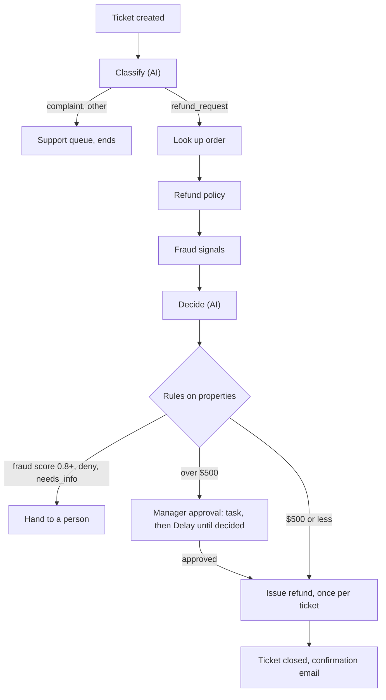

<!--
  README.md -- hubspot-graph-engineering-refund-workflow
  Author:  Jibril Sulaiman (with Claude Code)
  Date:    2026-10-19
  What:    A click-by-click guide to building a refund request workflow in HubSpot as a
           graph: small fixed steps that save to ticket properties, two AI judgments,
           plain rules for every branch, a manager approval wait and a one-time refund.
  Why:     Long HubSpot workflows with AI and code steps fail partway through and leave
           no record of what they knew. This pattern makes each step rerunnable,
           checkable and safe to repeat.
-->

# Graph Engineering in HubSpot Workflows: A Refund Request Build

A ticket-based HubSpot workflow that handles refund requests from start to finish. AI makes only two calls: sorting the ticket and drafting the decision. Plain rules and code do the rest: finding the Stripe charge, applying the refund policy, scoring fraud risk, sending large refunds to a manager, and issuing the refund exactly once.

> **Status: design only, never built or run.** This guide and its six code steps are a complete design. They pass a syntax check, but they have not been run against HubSpot, Stripe or the Claude API. Build it in a sandbox portal with Stripe test mode first, and expect to adjust labels and limits.

## Contents

- [Why it exists](#why-it-exists)
- [How it works](#how-it-works)
- [What's in this repo](#whats-in-this-repo)
- [Prerequisites and dependencies](#prerequisites-and-dependencies)
- [Setup, step by step](#setup-step-by-step)
  - [Step 1: Create the ticket properties](#step-1-create-the-ticket-properties)
  - [Step 2: Create the two API keys and secrets](#step-2-create-the-two-api-keys-and-secrets)
  - [Step 3: Create the workflow and trigger](#step-3-create-the-workflow-and-trigger)
  - [Step 4: Mark the run and copy the email](#step-4-mark-the-run-and-copy-the-email)
  - [Step 5: Classify (AI)](#step-5-classify-ai)
  - [Step 5, Breeze option: Classify with HubSpot's own AI](#step-5-breeze-option-classify-with-hubspots-own-ai)
  - [Step 6: Look up order](#step-6-look-up-order)
  - [Step 7: Refund policy](#step-7-refund-policy)
  - [Step 8: Fraud signals](#step-8-fraud-signals)
  - [Step 9: Decide (AI)](#step-9-decide-ai)
  - [Step 10: The rules branch](#step-10-the-rules-branch)
  - [Step 11: Manager approval](#step-11-manager-approval)
  - [Step 12: Issue refund and close](#step-12-issue-refund-and-close)
  - [Step 13: The Failed path](#step-13-the-failed-path)
  - [Step 14: Test every path](#step-14-test-every-path)
- [Troubleshooting](#troubleshooting)
- [Limits](#limits)
- [Security](#security)

## Why it exists

A long HubSpot workflow with AI and code steps usually fails somewhere in the middle, and when it does, nobody can see where or why. The usual design, one big code step or one AI agent that decides everything, has these problems:

| Problem in a long workflow | What this build does instead |
|---|---|
| One failure means starting over or fixing records by hand | Each step saves its result to its own ticket property, so only the failed step reruns |
| Small AI error rates stack up. 60 AI choices that are each 99% right all come out right only about 55% of the time (0.99^60) | Step order, amount limits, approvals and payments are fixed rules. Only 2 AI choices remain, about 98% |
| Nobody can tell what the workflow knew when it made a choice | Property history shows every value at every step and which step wrote it |
| Waiting on a manager leaves a request stuck or lost | A **Delay until** step waits as long as needed and carries on from where it stopped |
| A rerun can repeat an outside action, such as a refund or a customer message | Anything that touches Stripe runs at most once per ticket |
| One big code step is hard to test or change | Each step does one job, can be tested alone with the code action's **Test** button, and can be swapped without touching the rest |
| An AI answer goes straight into action unchecked | Each AI step returns a fixed JSON format, and code checks it before anything acts on it, such as confirming a cited policy clause exists |

HubSpot limits this design works around:

1. Workflow actions run one after another. There is no way to run three lookups side by side and wait for all of them, so they run in sequence.
2. A custom code action stops after 20 seconds. Both AI steps use low effort and short output, and the decide step stops retrying at a 14-second budget.
3. A code action that fails with a rate limit (429) or a server error (5xx) is retried by HubSpot on its own. Every code step here rethrows those errors and returns `status = error` for everything else, so a failure goes to a person instead of moving on silently.
4. HubSpot code actions can't install packages. The Claude calls use `axios` (built in) instead of the Anthropic SDK.

**When it is worth the extra setup.** Use this pattern when a workflow needs any of these: a pause for a person, recovery from a failure partway through, a record of what was known at every step, or money and messages that leave HubSpot. If it needs none of them, a plain workflow is simpler and just as good. Refund handling needs all four.

## How it works



Every step reads ticket properties and writes its own. The ticket is the shared state, so any step can be rerun from what the ticket already holds. Any code step that returns `status = error` goes to the Failed path ([Step 13](#step-13-the-failed-path)).

## What's in this repo

| Path | What it is | Where it gets pasted |
|---|---|---|
| [`code/`](code/) | The six Node.js 20 custom code actions, one per step | One file into each custom code action, Steps 5 to 9 and 12 |

## Prerequisites and dependencies

The whole build is done by hand in HubSpot, Stripe and the Claude Console. Claude Code was used only to draft the design and the code.

**Accounts, plans and tiers**

| What | Version or plan | Why | Check it's ready |
|---|---|---|---|
| HubSpot Service Hub | Professional or Enterprise | Ticket-based workflows | **Automation → Workflows → Create workflow** offers **Ticket-based** |
| HubSpot Data Hub (formerly Operations Hub) | Professional or Enterprise | Custom code actions | The **+** action menu lists **Custom code** (wording may differ) |
| Stripe account | Any, with test mode | Charge lookup, fraud history, refunds | Dashboard shows the **Test mode** toggle |
| Stripe Radar | Included with Stripe payments | `outcome.risk_level` on each charge, used by Fraud signals | A test charge's detail page shows a risk level |
| Claude API (Anthropic Console) | Pay-as-you-go | The two AI steps call `claude-opus-5-5` | A key is listed under **API keys** in the Console |
| HubSpot Credits (Breeze option only) | Professional or Enterprise in any of Marketing, Sales, Service, Data, Smart CRM or Revenue Hub, with credits in the account | The **Data Agent: Custom prompt** action uses credits on every run | Your account's credits usage page shows a balance (wording may differ) |
| Breeze AI settings (Breeze option only) | Generative AI tools and CRM data access turned on | Required before AI workflow actions run | The **AI** section appears in the workflow action menu |

**Permissions and scopes**

| What | Version or plan | Why | Check it's ready |
|---|---|---|---|
| HubSpot user access | Create properties, edit workflows | Steps 1 and 3 to 13 | You can open **Settings → Data Management → Properties** and create a workflow |
| Stripe restricted key | Charges **Read**, Customers **Read**, Disputes **Read**, Refunds **Write**, nothing else | Steps 6, 8 and 12 | The key's permission list shows only those four |
| HubSpot secret `REFUND_GRAPH_STRIPE` | Holds the Stripe restricted key | Read as `process.env.REFUND_GRAPH_STRIPE` | Listed in a code action's **Secrets** dropdown |
| HubSpot secret `REFUND_GRAPH_CLAUDE` | Holds the Claude API key | Read as `process.env.REFUND_GRAPH_CLAUDE` | Listed in a code action's **Secrets** dropdown |
| Claude API beta header | `server-side-fallback-2026-07-01` | Lets the API retry a declined request on a fallback model (`fallbacks: "default"`) | Sent by the code; no setup needed |

**Tools**

| What | Version or plan | Why | Check it's ready |
|---|---|---|---|
| HubSpot custom code runtime | Node.js 20.x, with `axios` built in | Runs every code step | Pick **Node.js 20.x** in the action's language menu |
| Node.js on your computer (optional) | 20 or later | `node --check` to catch paste errors before you paste | `node --version` |
| Git (optional) | Any | Cloning this repo | `git --version` |

**Claude Code (optional)**

| What | Version or plan | Why | What it can't do |
|---|---|---|---|
| Claude Code | Any current version | Drafted the design and the six code files | Nothing in this build was created in HubSpot or Stripe by Claude Code. No connectors or MCP servers were used, and the build needs none |

## Setup, step by step

Build everything in a sandbox HubSpot portal and Stripe test mode first. Leave the workflow off until [Step 14](#step-14-test-every-path) passes.

### Step 1: Create the ticket properties

About 20 minutes.

These fourteen properties are the workflow's shared state. Every step reads from and writes to them.

**1a. Open properties.** Click the gear icon (**Settings**) in the top bar. In the left menu, click **Data Management**, then **Properties**. In **Select an object**, choose **Ticket properties**.

**1b. Create the group.** Click the **Groups** tab, click **Create group**, name it `Refund graph`, click **Save**.

**1c. Create each property.** Click the **Properties** tab, click **Create property**, and create each row below in the **Refund graph** group. For dropdowns, add each value as its own option, with the label and internal value both set exactly as written.

| Label | Internal name | Field type | Written by | Values |
|---|---|---|---|---|
| Refund customer email | `rg_customer_email` | Single-line text | Step 4 | Email used to find the Stripe charge |
| Refund request type | `rg_request_type` | Dropdown select | Step 5 | `refund_request`, `complaint`, `other` |
| Refund order ID | `rg_order_id` | Single-line text | Step 6 | Stripe charge id, `ch_...` |
| Refund order amount | `rg_order_amount` | Number (currency) | Step 6 | Dollars |
| Refund order date | `rg_order_date` | Date picker | Step 6 | Purchase date |
| Refund policy clauses | `rg_policy_clauses` | Multi-line text | Step 7 | One clause per line, starting with its id, such as `2.1` |
| Refund fraud score | `rg_fraud_score` | Number | Step 8 | 0.00 to 1.00 |
| Refund decision | `rg_decision` | Dropdown select | Step 9 | `refund`, `deny`, `needs_info`, `fraud_review` |
| Refund cited clause | `rg_cited_clause` | Single-line text | Step 9 | A clause id from the policy list |
| Refund decision reason | `rg_decision_reason` | Multi-line text | Step 9 | One or two sentences for the rep |
| Refund approval status | `rg_approval_status` | Dropdown select | Step 11, then the manager by hand | `not_needed`, `pending`, `approved`, `denied` |
| Refund Stripe ID | `rg_refund_id` | Single-line text | Step 12 | Stripe refund id, `re_...` |
| Refund graph status | `rg_status` | Dropdown select | Every step | `running`, `waiting_on_manager`, `done`, `failed` |
| Refund graph error | `rg_error` | Multi-line text | Step 13 | Last error message |

> ⚠️ **Dropdown values must match the code exactly.** The code writes `refund_request`, not `Refund request`. If the internal value differs, the Edit record step fails or the branch in Step 10 never matches.

✅ **Check:** the **Refund graph** group lists 14 properties.

### Step 2: Create the two API keys and secrets

About 10 minutes.

**2a. Stripe restricted key.** In Stripe, switch on **Test mode**. Go to **Developers → API keys → Create restricted key** (wording may differ). Name it `HubSpot refund workflow`. Set **Charges: Read**, **Customers: Read**, **Disputes: Read**, **Refunds: Write**, and leave everything else at **None**. Click **Create key** and copy the `rk_test_...` value.

**2b. Claude API key.** In the Anthropic Console, go to **API keys → Create key**. Name it `HubSpot refund workflow` and copy the value.

**2c. Save them as HubSpot secrets.** Secrets are added from inside a custom code action, so this happens in [Step 5](#step-5-classify-ai): open the action, click the **Secrets** dropdown, click **Add secret**, and save:

| Secret name | Value |
|---|---|
| `REFUND_GRAPH_STRIPE` | The Stripe restricted key from 2a |
| `REFUND_GRAPH_CLAUDE` | The Claude API key from 2b |

> ⚠️ **Use one narrow key per job.** Don't reuse a Stripe key another workflow already depends on. Rotating a shared key breaks every workflow that uses it, with a 401 that names none of them.

✅ **Check:** both keys are copied somewhere safe until Step 5.

### Step 3: Create the workflow and trigger

About 5 minutes.

**3a. Create it.** Go to **Automation → Workflows**, click **Create workflow**, then **From scratch**. Choose **Ticket-based**, then **Blank workflow**, and click **Next**.

**3b. Name it.** Click the pencil icon at the top and name it `Refund Request Graph`.

**3c. Trigger.** Click **Set up triggers**, choose **When filter criteria is met**. Add **Pipeline** *is any of* your support pipeline. Click **Save**.

**3d. Re-enrollment.** Leave it off. Each ticket runs the workflow once.

✅ **Check:** the trigger card shows the pipeline filter and re-enrollment is off.

### Step 4: Mark the run and copy the email

About 5 minutes.

**4a. Status.** Click **+** under the trigger, choose **Edit record**, set **Refund graph status** to `running`, click **Save**.

**4b. Copy the email.** Click **+**, choose **Copy property value** (wording may differ). Copy from the associated **Contact**'s **Email** to the ticket's **Refund customer email**. Click **Save**.

> ⚠️ **Ticket workflows can't pass contact fields into code.** The code steps only see the enrolled ticket's properties, which is why the email is copied onto the ticket first.

✅ **Check:** two actions under the trigger.

### Step 5: Classify (AI)

About 10 minutes.

**5a. Add the custom code action.** Click **+**, choose **Custom code**.
1. **Language:** Node.js 20.x
2. **Secrets:** click **Add secret** and add both secrets from [Step 2c](#step-2-create-the-two-api-keys-and-secrets). Tick `REFUND_GRAPH_CLAUDE` for this action.
3. **Property to include in code**, one row per input:

   | Input name (left box) | Value (right box) |
   |---|---|
   | `subject` | **Ticket → Ticket name** |
   | `content` | **Ticket → Ticket description** |

4. Delete the sample code and paste in **all** of [`code/1-classify.js`](code/1-classify.js).
5. **Data outputs**, one row per output:

   | Output | Type |
   |---|---|
   | `request_type` | String |
   | `status` | String |

**5b. Test action.** Pick a test ticket that asks for money back. Success looks like: `request_type = refund_request`, `status = ok`.

| You got | Cause | Fix |
|---|---|---|
| `status = error`, log says 401 | Wrong or missing Claude key | Re-add `REFUND_GRAPH_CLAUDE` and tick it on this action |
| Action timed out | The call ran past 20 seconds | Keep `effort: 'low'` and `max_tokens` as shipped |

**5c. Save the result.** Click **+**, choose **Edit record**, set **Refund request type** to the action's `request_type` output (**Insert data → action outputs**, wording may differ).

**5d. Branch.** Click **+**, choose **Branch**, based on **Refund request type**:

| Branch | Add on that branch |
|---|---|
| `complaint` | Rotate owner to your support team, then end |
| `other` | End (the ticket stays in the normal queue) |
| `refund_request` | Continue to Step 6 |
| Classify `status = error` | **Go to action** → Step 13 (branch on the `status` output first, wording may differ) |

✅ **Check:** a refund test ticket reaches the `refund_request` branch and a complaint does not.

### Step 5, Breeze option: Classify with HubSpot's own AI

About 10 minutes. Use this **instead of** 5a to 5c if you'd rather not call Claude for this step. Decide ([Step 9](#step-9-decide-ai)) stays in code either way.

**5a (Breeze). Add the AI action.** Click **+**, open the **AI** section, choose **Data Agent: Custom prompt** (wording may differ). It is marked Beta.

**5b (Breeze). Write the prompt.** In **Message**, paste the prompt below. Replace the two bracketed lines with the **Ticket name** and **Ticket description** tokens from the data panel. The prompt can be up to 3,000 characters. The AI sees only what is in the prompt.

```text
Sort this customer support ticket into exactly one category.
refund_request: the customer wants money back for a purchase.
complaint: the customer is unhappy but is not asking for money back.
other: anything else, such as a login problem or a question.
If the ticket both complains and asks for money back, answer refund_request.
Answer with the category only.

Ticket name: [insert the Ticket name token]
Ticket description: [insert the Ticket description token]
```

**5c (Breeze). Fix the output.** Define the output as an **Enumeration** with three values: `refund_request`, `complaint`, `other`. A fixed list keeps the answer usable in the branch.

**5d (Breeze). Test action.** Pick a test ticket that asks for money back. Success looks like: the action shows Success and the response is `refund_request`.

**5e (Breeze). Save and branch.** Add **Edit record**: Refund request type = the action's **Response**. Then add **Branch → One property or action output**, and under **Action data** pick the Data Agent action and its **Response**:

| Response | Add on that branch |
|---|---|
| `refund_request` | Continue to Step 6 |
| `complaint` | Rotate owner to your support team, then end |
| `other` | End |
| Empty | **Go to action** → [Step 13](#step-13-the-failed-path) |

> ⚠️ **An empty response is how Breeze fails.** When the account runs out of credits, the action fails and writes nothing instead of raising an error. Without the Empty branch, those tickets stall with no type.

**Trade-offs against the Claude code step:**

| | Breeze Data Agent | Claude in a code step ([`code/1-classify.js`](code/1-classify.js)) |
|---|---|---|
| Setup | No code and no API key | Code action, a secret and a Claude API key |
| Cost | HubSpot Credits on every run | Claude API billing on every run |
| Status | Beta | Generally available API |
| When it fails | Out of credits: empty response, no error | `status = error`, and HubSpot retries rate-limit and server errors |
| Output control | Fixed list of values (Enumeration) | Strict JSON schema |
| Model | HubSpot chooses | Pinned to `claude-opus-5-5` |
| Time limit | None published | 20 seconds per code action |

**Why Decide stays in code.** Decide has to cite a policy clause, and the code confirms that clause really exists before anything acts on it, retrying up to 3 times if it doesn't. A Breeze action answers once, and a branch can't check one property's value against a list held in another, so a made-up clause would go straight through.

Sources: [Use Breeze to manage data in workflows](https://knowledge.hubspot.com/workflows/use-ai-to-manage-data-in-workflows), [Choose your workflow actions](https://knowledge.hubspot.com/workflows/choose-your-workflow-actions).

✅ **Check:** a refund test ticket reaches the `refund_request` branch, and a ticket run with no credits left lands on the Failed path.

### Step 6: Look up order

About 10 minutes.

**6a. Add the custom code action.** On the `refund_request` branch, click **+**, choose **Custom code**.
1. **Language:** Node.js 20.x
2. **Secrets:** tick `REFUND_GRAPH_STRIPE`.
3. **Property to include in code:**

   | Input name (left box) | Value (right box) |
   |---|---|
   | `rg_customer_email` | **Ticket → Refund customer email** |

4. Delete the sample code and paste in **all** of [`code/2-look-up-order.js`](code/2-look-up-order.js).
5. **Data outputs:**

   | Output | Type |
   |---|---|
   | `order_id` | String |
   | `order_amount` | Number |
   | `order_date` | Date |
   | `status` | String |

**6b. Test action.** Use a ticket whose email has a paid test charge. Success: `status = found` and an `order_id` starting `ch_`.

**6c. Branch on `status`:**

| `status` | Add on that branch |
|---|---|
| `found` | **Edit record**: save `order_id`, `order_amount`, `order_date` to the three Refund order properties, then continue |
| `not_found` | **Edit record**: Refund decision = `needs_info`. **Create task** for the ticket owner, then end |
| `error` | **Go to action** → Step 13 |

> ⚠️ **Only the newest unrefunded charge is used.** A customer with several recent purchases may mean an older one. The rep can correct **Refund order ID** by hand before Step 12 runs.

✅ **Check:** the three order properties are filled on the test ticket.

### Step 7: Refund policy

About 5 minutes.

**7a. Add the custom code action.** Click **+**, choose **Custom code**. No secret.
1. **Language:** Node.js 20.x
2. **Property to include in code:**

   | Input name (left box) | Value (right box) |
   |---|---|
   | `rg_order_date` | **Ticket → Refund order date** |
   | `rg_order_amount` | **Ticket → Refund order amount** |
   | `content` | **Ticket → Ticket description** |

3. Delete the sample code and paste in **all** of [`code/3-refund-policy.js`](code/3-refund-policy.js).
4. **Data outputs:**

   | Output | Type |
   |---|---|
   | `clauses` | String |
   | `status` | String |

**7b. Edit the policy.** The three clauses in `POLICY`, the 30-day window and the $500 limit are placeholders. Replace them with your real policy before testing. Keep each clause id in the `2.1` format, because Step 9 checks citations against it.

**7c. Test action.** Success: `clauses` lists one line per clause that applies, each with a *Fact:* note.

**7d. Save it.** **Edit record**: Refund policy clauses = `clauses`.

✅ **Check:** **Refund policy clauses** on the test ticket starts with `2.1`.

### Step 8: Fraud signals

About 5 minutes.

**8a. Add the custom code action.** Click **+**, choose **Custom code**.
1. **Language:** Node.js 20.x
2. **Secrets:** tick `REFUND_GRAPH_STRIPE`.
3. **Property to include in code:**

   | Input name (left box) | Value (right box) |
   |---|---|
   | `rg_order_id` | **Ticket → Refund order ID** |
   | `rg_customer_email` | **Ticket → Refund customer email** |

4. Delete the sample code and paste in **all** of [`code/4-fraud-signals.js`](code/4-fraud-signals.js).
5. **Data outputs:**

   | Output | Type |
   |---|---|
   | `fraud_score` | Number |
   | `status` | String |

**8b. Test action.** Success: `status = ok` and a log line such as `risk_level=normal disputes=0 earlier_refunds=0 score=0`.

**8c. Save it.** **Edit record**: Refund fraud score = `fraud_score`.

> ⚠️ **The weights are placeholders.** `WEIGHTS` in the file is a starting point. Tune it against your own refund and dispute history before going live.

✅ **Check:** **Refund fraud score** is filled on the test ticket.

### Step 9: Decide (AI)

About 10 minutes.

**9a. Add the custom code action.** Click **+**, choose **Custom code**.
1. **Language:** Node.js 20.x
2. **Secrets:** tick `REFUND_GRAPH_CLAUDE`.
3. **Property to include in code:**

   | Input name (left box) | Value (right box) |
   |---|---|
   | `content` | **Ticket → Ticket description** |
   | `rg_order_amount` | **Ticket → Refund order amount** |
   | `rg_order_date` | **Ticket → Refund order date** |
   | `rg_policy_clauses` | **Ticket → Refund policy clauses** |
   | `rg_fraud_score` | **Ticket → Refund fraud score** |

4. Delete the sample code and paste in **all** of [`code/5-decide.js`](code/5-decide.js).
5. **Data outputs:**

   | Output | Type |
   |---|---|
   | `decision` | String |
   | `cited_clause` | String |
   | `reason` | String |
   | `status` | String |

**9b. Test action.** Success: `status = ok`, `decision` is one of `refund`, `deny`, `needs_info`, `fraud_review`, and `cited_clause` is an id from **Refund policy clauses**.

**9c. Save it.** **Edit record**: Refund decision = `decision`, Refund cited clause = `cited_clause`, Refund decision reason = `reason`. Then branch on `status`: `error` → **Go to action** → Step 13.

> ⚠️ **The check is what makes the AI safe to act on.** If the model cites a clause that isn't in the list, the code asks again, up to 3 times within 14 seconds, then fails to a person. Don't remove that check to save time.

✅ **Check:** the three decision properties are filled and the cited clause exists in the policy list.

### Step 10: The rules branch

About 10 minutes.

**10a. Add it.** Click **+**, choose **Branch → Based on filter criteria** (wording may differ). Add these branches in this order. The first match wins.

| Order | Branch name | Filter | Add on that branch |
|---|---|---|---|
| 1 | Fraud review | **Refund fraud score** is greater than or equal to 0.8, OR **Refund decision** is `fraud_review` | **Create task** for your refund manager, **Edit record** Refund graph status = `waiting_on_manager`, end |
| 2 | Deny | **Refund decision** is `deny` | **Send email** with the denial message, set ticket status to **Closed** |
| 3 | Needs info | **Refund decision** is `needs_info` | **Send email** asking for the missing item (such as a photo), set ticket status to **Waiting on contact** |
| 4 | Over $500 | **Refund decision** is `refund` AND **Refund order amount** is greater than 500 | Continue to Step 11 |
| None met | Refund, $500 or less | | **Go to action** → Step 12 |

> ⚠️ **Keep the amount limit in two places in sync.** The $500 here and `APPROVAL_OVER_USD` in [`code/3-refund-policy.js`](code/3-refund-policy.js) must match, or the policy text tells the AI one thing while the branch does another.

✅ **Check:** each test ticket from Step 14 lands on the branch in the table.

### Step 11: Manager approval

About 10 minutes.

**11a. Ask for approval.** On the **Over $500** branch:
1. **Edit record**: Refund approval status = `pending`, Refund graph status = `waiting_on_manager`.
2. **Create task** for the refund manager: `Approve refund on this ticket`.
3. **Send internal notification** to the same person.

**11b. Wait.** Click **+**, choose **Delay → Delay until event occurs** (wording may differ). Event: **Refund approval status** is any of `approved`, `denied`. Set the maximum wait to 2 business days.

**11c. After the wait, branch on Refund approval status:**

| Value | Add on that branch |
|---|---|
| `approved` | **Go to action** → Step 12 |
| `denied` | **Send email** with the denial message, set ticket status to **Closed** |
| Timed out | Reassign the task to the backup approver |

> ⚠️ **Nothing is held open while it waits.** The ticket simply sits in the delay. The manager approves by setting **Refund approval status** on the ticket, so tell them which field to change.

✅ **Check:** setting a waiting test ticket to `approved` moves it to Step 12.

### Step 12: Issue refund and close

About 10 minutes.

**12a. Add the custom code action.** Click **+**, choose **Custom code**.
1. **Language:** Node.js 20.x
2. **Secrets:** tick `REFUND_GRAPH_STRIPE`.
3. **Property to include in code:**

   | Input name (left box) | Value (right box) |
   |---|---|
   | `hs_object_id` | **Ticket → Ticket ID** (wording may differ) |
   | `rg_order_id` | **Ticket → Refund order ID** |
   | `rg_order_amount` | **Ticket → Refund order amount** |

4. Delete the sample code and paste in **all** of [`code/6-issue-refund.js`](code/6-issue-refund.js).
5. **Data outputs:**

   | Output | Type |
   |---|---|
   | `refund_id` | String |
   | `status` | String |

**12b. Test action, twice.** Run it once: success is `status = ok` and a `refund_id` starting `re_`. Run it again on the same ticket: it must return the **same** `refund_id`, and Stripe test mode must show one refund, not two.

**12c. Close the ticket.** Branch on `status`. On `ok`: **Edit record** Refund Stripe ID = `refund_id`, Refund graph status = `done`, ticket status = **Closed**, then **Send email** with the refund confirmation. On `error`: **Go to action** → Step 13.

> ⚠️ **A rerun must never pay twice.** If the step crashes after Stripe accepts the refund, HubSpot may run it again. The code first looks for a refund already tagged with this ticket id, then sends the ticket id as Stripe's `Idempotency-Key`. Stripe keeps idempotency keys for 24 hours, which is why the tag check is there too.

✅ **Check:** the test ticket is Closed with a Refund Stripe ID, and Stripe shows exactly one refund.

### Step 13: The Failed path

About 5 minutes.

**13a. Build it once.** Add these actions in their own branch, and point every `status = error` branch here with **Go to action**:
1. **Edit record**: Refund graph status = `failed`.
2. **Create task** for the ticket owner: `Refund workflow failed: finish by hand`.

✅ **Check:** a ticket whose email has no Stripe key access ends with Refund graph status = `failed` and a task.

### Step 14: Test every path

About 30 minutes.

**14a. Run each case** on a test ticket in Stripe test mode:

| Case | Ticket text | Expected path |
|---|---|---|
| Small refund | "My $120 order arrived broken, photo attached" | Classify `refund_request`, decide `refund`, issue refund, Closed |
| Large refund | "My $640 espresso machine arrived cracked, photo attached" | Over $500, manager task, waits, refunds after approval |
| Manager away | Same as above, no approval for 2 business days | Timeout, task moves to the backup approver |
| Complaint | "Your support line kept me on hold for an hour" | Classify `complaint`, routed to support, no refund |
| No order found | Email with no Stripe charge | `needs_info`, task to the ticket owner |
| High fraud score | Customer with an open dispute | Fraud review, no refund |
| Crash mid-refund | Run Issue refund twice on the same ticket | Second run returns the same refund id, customer paid once |
| Bad AI citation | Edit the decide prompt to cite clause 9.9 | Rejected, retried, fails after 3 attempts and goes to a person |

**14b. Review and publish.** Click **Review and publish** to check for errors. Turn the workflow on only after every case passes, then swap the Stripe test key for a live restricted key with the same four permissions.

✅ **Check:** all eight cases match the table.

## Troubleshooting

| Symptom | Cause | Fix |
|---|---|---|
| A code action times out | The Claude call ran past HubSpot's 20 seconds | Keep the shipped `effort: 'low'` and `max_tokens`. [Step 5](#step-5-classify-ai), [Step 9](#step-9-decide-ai) |
| Branch never matches | Dropdown internal values differ from the code | Match them exactly. [Step 1](#step-1-create-the-ticket-properties) |
| Look up order returns `not_found` for a paying customer | The charge carries a different email, or it was just made and Stripe search hasn't caught up | Check the email on the Stripe charge. Search can lag by about a minute. [Step 6](#step-6-look-up-order) |
| Stripe returns 401 | Wrong key, or a test key against live data | Re-save `REFUND_GRAPH_STRIPE`. [Step 2](#step-2-create-the-two-api-keys-and-secrets) |
| Decide fails every time | **Refund policy clauses** is empty | Check Step 7 saved its output. [Step 7](#step-7-refund-policy) |
| Refund fails with "already refunded" | The charge was refunded outside this workflow | Close the ticket by hand. [Step 12](#step-12-issue-refund-and-close) |
| Breeze Classify leaves Refund request type empty | The account ran out of HubSpot Credits, so the action wrote nothing | Add credits, and keep the Empty branch. [Step 5, Breeze option](#step-5-breeze-option-classify-with-hubspots-own-ai) |
| Edit record fails on the order date | The output isn't typed **Date** | Set `order_date` to Date. [Step 6](#step-6-look-up-order) |

## Limits

- **Never run.** See the status note at the top.
- **No parallel steps.** HubSpot runs actions in turn, so the three lookups take about three times as long as they would side by side.
- **Fixed path.** A request that needs something new, such as a partial refund or a replacement, falls to a person.
- **Full refunds of the newest charge only.** Partial refunds and multi-charge orders are out of scope.
- **Placeholders.** The policy clauses, the $500 limit, the 0.8 fraud cut-off and the fraud weights all need your own values.
- **AI cost.** Each refund request makes two to four Claude calls at low effort. With the Breeze option, Classify uses HubSpot Credits instead and Decide still calls Claude.

## Security

- The Stripe key is restricted to four permissions and lives only in a HubSpot secret, never in code.
- Build and test with a Stripe test key. Switch to a live restricted key only after Step 14 passes.
- The code logs Stripe error bodies on failure. Review the logs before sharing them, because they can include customer details.

Built by [Jibril Sulaiman](https://github.com/carljibrilsulaimanii).
